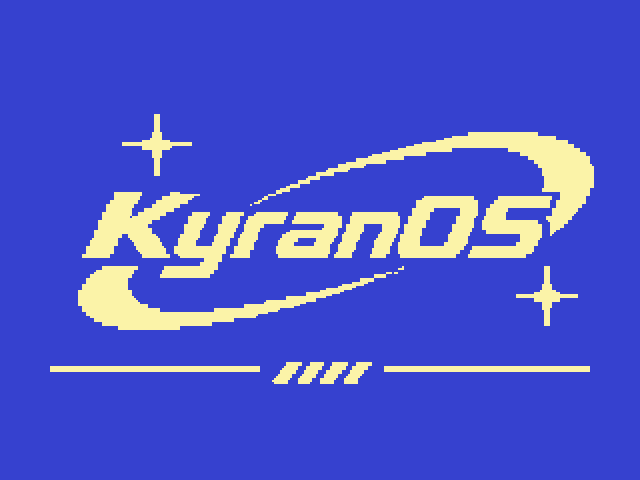
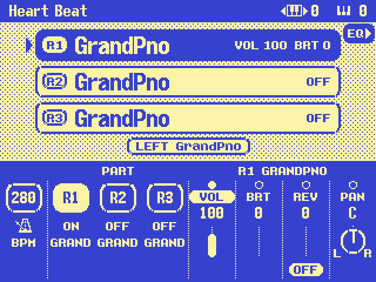
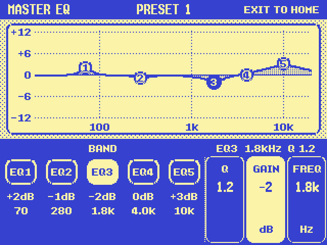

# KyranOS: PSR-9000 firmware mod

A custom firmware mod for the **Yamaha PSR-9000** arranger keyboard (main firmware V3.06),
plus a **MAME emulator** for the keyboard so every change can be tested on a PC first.

The keyboard is used live at church, so the rule is: **keep every sound and style exactly as it
is**, and change the parts that get in the way when playing. The mod patches Yamaha's existing
firmware (new code in unused flash space, hooks into existing screens and buttons). It is not a
rewrite from scratch.

> **No Yamaha files are in this repository.** The firmware update files and the service manual
> are copyrighted. Get the V3.06 update (`PSR9000_OS306.zip`) from Yamaha's support site and put
> the files in `firmware/` (git-ignored). The mod reads Yamaha's fonts and icons from the
> keyboard's own firmware while it runs, so none of it is copied into our code.

## Goals

1. **A new home screen** that shows what matters when playing live: the active layers
   (R1 / R2 / R3 voice and on/off) in the centre, and the controls for the selected layer on the
   buttons under the screen, changed with the data dial.
2. **A cleaner, more modern look** that still feels like the PSR-9000 on its 1-bit LCD.
3. **New features**, starting with a graphical Master EQ page.
4. **Custom boot splash** (KyranOS).
5. **An emulator** (MAME driver) so all of this can be tried without risking the keyboard.
6. Later: custom multi-sample voices, more pages, using the 10 side buttons for new functions.

## What works so far

### Emulator (MAME driver)
- Runs the real V3.06 main firmware: boots to the home screen, and every page in the manual
  opens (147 panel buttons, all 68 Direct Access combinations, Function / Mixing Console /
  Song / Disk menus). Full test report: [docs/TEST_REPORT.md](docs/TEST_REPORT.md).
- Clickable panel layout modelled on the real keyboard, data dial, LCD in the real colours.
- Windows build (`psr9000.exe`) with start scripts; the LCD is shown pixel-exact
  (whole-number zoom).
- Floppy drive: style files (.sty) load from disk images into the style flash, exactly like
  on the keyboard (Style Manager), and play; `tools/make_floppy.py` builds the disk images.
- MIDI A/B ports connected to the PC: the emulated keyboard's MIDI OUT can play a Windows synth
  or, through a virtual MIDI cable (loopMIDI), VST instruments such as Keyscape; MIDI IN takes a
  USB MIDI keyboard.
- Not emulated: sound and the sound board (faked), and the voice/preset-style ROM chips,
  whose contents are not public. So there is no audio inside the emulator (style and keyboard
  notes can go out over MIDI), and preset styles only work once loaded from disk.
- Details: [docs/EMULATOR.md](docs/EMULATOR.md).

### Firmware mod ([mod/home](mod/home), [docs/HOME_MOD.md](docs/HOME_MOD.md))
- **Home screen:**
  - Blue status bar: style name, transpose and octave.
  - Layer cards for R1/R2/R3: voice name, VOL/BRT, on or off. The LEFT voice is shown below them.
  - Bottom row:
    - LCD 1 = TEMPO.
    - LCD 2–4 = select R1/R2/R3.
    - LCD 5–8 = VOL / BRT / REV / PAN for that layer, with the data dial changing the value.
    - Reverb DOWN = on/off, restoring the previous level.
  - Drawn with Yamaha's own bitmap fonts, flicker-free.

 
<em>The new home screen, running in the emulator (every voice shows "GrandPno" there because
the voice ROM chips are not emulated)</em>

- **Master EQ page** (side button F on the home screen):
  - LCD 1–5 pick the band; LCD 6–8 pick Q / GAIN / FREQ; the dial changes the value.
  - A live EQ curve graph. EXIT returns home.
  - The stock Mixing Console EQ page still works too.

 
<em>The Master EQ page</em>

- **KyranOS boot splash** (Kyran's logo, top of this page).
- Builds to a patch list. For the emulator the patch is applied in memory
  (`mod/home/build/apply.lua`), so the ROM files stay untouched. `make_image.py` writes patched
  firmware files with both checksums fixed, for a future real-keyboard test.

### Reverse engineering (notes in [CLAUDE.md](CLAUDE.md))
- Firmware layout, both integrity checks (re-implemented in `tools/romcheck.py`).
- UI image pack decoder (`tools/res_extract.py`: all 1030 images), bitmap fonts, framebuffer and
  LCD refresh path.
- Button IDs, event tables, data dial, and the parameter API for part volume, pan,
  brightness, reverb and the Master EQ.

### On the real keyboard
Nothing has been installed on the keyboard yet. Everything above runs in the emulator.
Before the first real test, read the recovery plan in [docs/RECOVERY.md](docs/RECOVERY.md):
the installer lives in a protected boot area, so the original firmware can be reinstalled
from Yamaha's disks.

Screenshots in `docs/images/` are emulator captures at 2x. To refresh them after a design
change, capture again in the emulator.

## Repository layout

| Folder | What |
|---|---|
| `mod/home/` | The firmware mod: C code (`hp.c`), build script, patch output |
| `mockups/` | Python mockups of every screen design (`home_v10.py`, `eq_v3.py` are current) |
| `mame/` | MAME driver (`ympsr9000.cpp`), panel layout, core patches, test scripts, Windows start files |
| `tools/` | Checksum, image extractor, disassembly helpers |
| `docs/` | Emulator notes, mod notes, test report, recovery plan |
| `firmware/`, `docs/private/` | Yamaha files (git-ignored, never committed) |

## Trying it

1. Build or get `psr9000.exe` (see [docs/EMULATOR.md](docs/EMULATOR.md)) and follow
   `mame/windows/README.txt`.
2. Copy Yamaha's five V3.06 files into `roms\psr9000`.
3. Start `START_PSR9000_NEW_HOME.bat` for the modded firmware, or `START_PSR9000.bat` for stock.

To rebuild the mod: `python3 mod/home/build.py` (needs `sh4-linux-gnu-gcc`, Python 3, Pillow
and the Yamaha files in `firmware/`).
