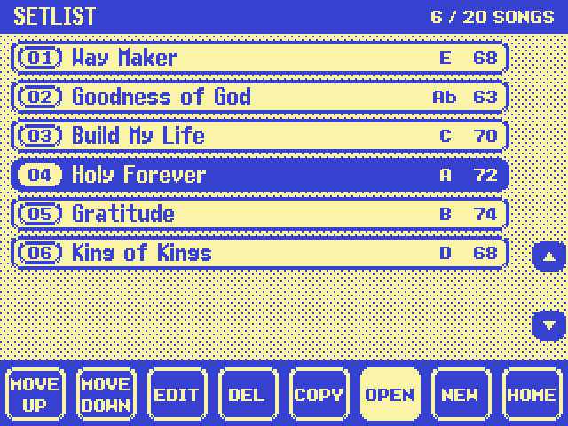
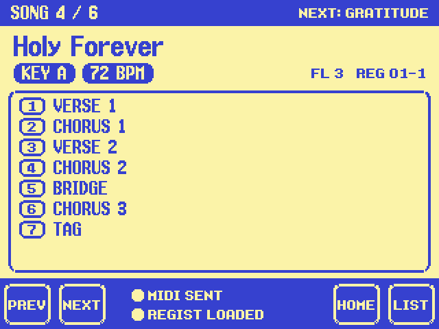

# KyranOS Setlist / Performance mode

Design: `mockups/setlist_v1.py` (setlist viewer, edit/new song, performance, confirm dialogs)
and `mockups/home_v12.py` (SET tab on side button G). Code: `mod/home/setlist.c` (included by
`hp.c`). Everything below is verified in the emulator; nothing of it has run on the real keyboard
yet.

## Using it

- **Home > side button G (SET)** opens the setlist. If a song is being performed, the
  performance screen comes back instead (as it was left with HOME).
- **Setlist viewer**: dial or side buttons I / J select a song.
  - LCD 1 MOVE UP / LCD 2 MOVE DOWN.
  - LCD 3 EDIT.
  - LCD 4 DEL: asks first; only the song entry goes, the registration and FL configuration stay.
  - LCD 5 COPY: an independent duplicate with a new id.
  - LCD 6 OPEN: activates the song and opens the performance screen.
  - LCD 7 NEW.
  - LCD 8 HOME.
- **New / edit song**:
  - Side buttons A-E pick TITLE, KEY, BPM, FL CONFIG or REGIST, and the dial changes that value.
    The REGIST dial steps through BANK 01-1 .. BANK 64-8.
  - I / J pick a section of the arrangement, and the dial changes its type.
  - LCD 1 ADD (a section after the selected one), LCD 2 DEL, LCD 3 MOVE UP, LCD 4 MOVE DOWN.
  - LCD 6 NAME opens the naming screen.
  - LCD 7 BACK asks before throwing changes away.
  - LCD 8 SAVE. Changes only count after SAVE: an edited song replaces only itself, and a new
    song is added at the end.
- **Naming screen** (laid out like Yamaha's): the dial picks a character, side D / E change the
  row.
  - LCD 1 CLR, LCD 2 DEL, LCD 3 / 4 move the cursor (moving right at the end adds a space).
  - LCD 5 ENTRY writes the character at the cursor.
  - LCD 7 CANCEL, LCD 8 END. Up to 15 characters.
- **Performance screen**: the title (largest), the key and BPM, and the FL configuration and
  registration numbers.
  - The full arrangement is shown for information only; nothing plays by itself.
  - LCD 1 PREV / LCD 2 NEXT ask first and show the destination song. YES = side G, NO = side H
    or EXIT. The first and last songs have no PREV / NEXT.
  - LCD 7 HOME keeps the song active: no reload, no MIDI.
  - LCD 8 LIST opens the viewer.
- **Status lights** (bottom middle of the performance screen): filled = done, ring = waiting,
  X = failed.
  - MIDI SENT: the notes really left the MIDI ports.
  - REGIST LOADED: the registration memory was recalled.
- **EXIT** goes one level back everywhere (naming > edit > list > home; performance > home).
- Section types: INTRO, VERSE, PRE-CHORUS, CHORUS, POST-CHORUS, BRIDGE, INSTRUMENTAL,
  INTERLUDE, TURNAROUND, BREAKDOWN, VAMP, TAG, REFRAIN, OUTRO, ENDING. A type that appears more
  than once is numbered automatically (CHORUS 1, CHORUS 2, ...).
- Keys are root notes only, shown with flats (C C# D Eb E F F# G Ab A Bb B). BPM is for display
  only: the registration decides the tempo.
- Limits: 20 songs, 15-character titles, 16 sections per song.

## What a song does when it is activated (OPEN, or a confirmed PREV / NEXT)

1. **Registration**: bank set with message (11, 1, bank), then memory recall (11, 5, memory).
   These are the same messages the panel's REGIST BANK and REGIST buttons post.
2. **MIDI** on MIDI A and MIDI B (each port that is switched on):
   - channel 15: note-on velocity 127 then note-off, note number = FL Studio configuration ID
     (0-127);
   - channel 16: the same with note 60-71 = the song's key (C = 60 ... B = 71).
3. FL Studio side: `tools/fl_studio/` (selects the drone pattern C, C#, ... B by name; sharps,
   so Eb arrives as D#, and so on).

## Storage

- File `KYRANOS.SET` in the root of the floppy in the drive:
  - 8-byte header `KSET`, version 1, song count, next id, 0;
  - then 40 bytes per song: id, key, BPM (2 bytes), FL config, bank 0-63, memory 0-7, number
    of sections, title (16 bytes, zero-terminated), 16 section types.
- The setlist is read the first time it opens after power-on. Changes are saved at once:
  - SAVE in the editor, DEL, COPY;
  - moves are saved when the viewer is left (HOME, OPEN, EDIT, NEW, EXIT).
- No file on the disk (or no disk): the message "NO SETLIST ON DISK, starting a new setlist";
  the file is created on the first save.
- A damaged file is reported and left alone. Saving would replace it, so take that disk out if
  you want to keep it.
- A save failure (no disk, write protected) shows "COULD NOT SAVE". The setlist stays in memory
  until power-off.
- The disk must be a 1.44 MB DOS disk, as for styles. The file can be copied and backed up on a
  PC.

## Firmware facts used (main program V3.06)

### Memory: the kernel's block pool
Yamaha's own small kernel has about 40 services and no general heap:
- trapa #63 with r0 = code -0x101 .. -0x127;
- function table at 0x2056C, dispatcher 0x2105C.

It has 3 fixed-size block pools. Definitions are at 0x20544; the control blocks are in on-chip
RAM at 0xFFFFFF6C + 16 * (pool - 1): +0 u16 waiting tasks, +4 free list, +12 u32 free count.

| pool | blocks | block | area | used for |
|---|---|---|---|---|
| 1 | 19 | 0x10C apart: 4-byte tag + 0x108 (264) bytes | 0x12BB2E4 | small buffers |
| 2 | 1 | 1 MB | 0x12BC6C8 | "public memory" (one owner at a time) |
| 3 | 1 | 200 KB | 0x13BC6CC | "public memory" |

- **0x22BA4(void \*\*out, pool)** = get a block without waiting (code -0x122). Returns 0 and
  the block pointer in \*out (block + 4; the kernel writes the tag `_MBK` at block + 0), or
  0xF1A7 when the pool is empty.
- Blocking get = code -0x121 (0x21468). Release = 0x22C0C (code -0x123).
- The "public memory" wrappers use pools 2 and 3:
  - 0x22CEE / 0x22E04 request (the owner id is stored at 0x1000000 / 0x1000002);
  - 0x22F16 release;
  - error text "Public Memory Request Error!!" (sys_lib.c).
- Measured in the emulator (boot, a full style disk loaded into flash, setlist use): pool 1
  never had more than 1 of its 19 blocks in use before the setlist.
- **The setlist takes 5 pool-1 blocks once and keeps them (14 stay free).**
  - Block 0 holds the state (`struct sl`, 116 bytes) and is found again by scanning the 19
    blocks for the magic `KyOS-SL1`, so no pointer has to be kept anywhere.
  - Blocks 1-4 hold 6 songs each.

### MIDI out
- MIDI A/B = channels 0/1 of the external quad 16550 UART at 0x980000 (channel n at +0x20n,
  register r at +4r+3). Port descriptors in ROM at 0x337480 (A) / 0x3374C4 (B), copied to RAM
  0x1093800 + 68 * port.
- Send ring per port:
  - 4 KB at 0x10917F8 + 0x1004 * port;
  - u16 write index at +0x1000, u16 read index at +0x1002.
  - The transmit interrupt 0x8A07E sends one byte per interrupt and switches itself off when
    the ring is empty. 0x89FE4(port) switches it on.
- **0x2562FC(const u8 \*msg, int len, int port)** = the firmware's "send MIDI message":
  - skips the port when its off flag 0x11A5AE0[4 * port] is set;
  - raises the interrupt mask to 10 (0x22C94 / 0x22CB8), so bytes from different tasks never
    interleave;
  - 0x256202 handles running status: the last status per port is at 0x11A4A58 + 4 * port and
    is re-sent at least every 300 ticks;
  - 0x256090 copies the bytes into the ring.
- MIDI SENT check: after sending, remember the ring's write index. The message has left once
  the read index has passed it (the interrupt advances it only after handing a byte to the
  UART).
  - activate() waits up to a few ms for that; hp_tick checks again.
  - Not done within 3 ticks, or both ports switched off = FAILED.

### Registration memory
Category 11 messages (table 0x3BF794), posted with **0x25CDE(11, id, byte)**:
- id 1 = set the bank directly (0-63; handler 0x2BBD64 writes 0x11AF1A8).
- id 5 = recall memory 0-7 of the current bank. Handler 0x2BBDE0:
  - skips when 0x2CAAEE() says busy;
  - writes the requested memory to 0x11AF25E;
  - checks that it exists with **0x2BB778(bank, mem)**;
  - sets the current memory 0x11AF1AA;
  - loads with 0x29CE94(0x2BAD14, bank, mem).
- ids 2 / 3 = bank + / -. REGIST n buttons = 0x6F + (n - 1) (handler 0x6A5F0 -> (11, 5, n - 1)).
- REGIST LOADED check:
  1. If 0x2BB778 says the memory does not exist: FAILED at once, nothing is posted.
  2. Otherwise write 0xFF to 0x11AF25E as a marker, then post.
  3. LOADED when 0x11AF25E == memory and 0x11AF1A8 / 0x11AF1AA == bank / memory.
  4. Not within 5 ticks = FAILED.

### Files on the floppy
- UI code never touches files itself: it posts category-9 messages to the disk task. For
  example, the song recorder saves RMDRV:/RAMFILE.MID to FDDRV:/NEWSONG.MID (0x1DF6B4).
- The low-level file system (0x302000-0x312000) guards every call with kernel semaphore 24
  (code -0x118 wait / -0x117 signal), so it can be called from the UI task. Calls used:

  | address | call | notes |
  |---|---|---|
  | 0x30243E | open(path, mode) | returns a file number >= 0 or an error < 0. Mode 0 = read; mode 4 = create, but on an existing file it APPENDS (what DISK.MNG uses). |
  | 0x302510 | read(fd, buf, len) | returns the bytes read |
  | 0x3025A6 | write(fd, buf, len) | < 0 = error |
  | 0x302482 | close(fd) | |
  | 0x302618 | delete(path) | the disk task's case before RENAME (0x30270C) |
  | 0x22CD06 | flush("FDDRV") | -> 0x3132BE: device record by name, 0x30B908. The firmware calls it after its own disk writes. |
  | 0x22B28A | drive_path("FDDRV", out) | drive name -> file-system path prefix (table RAM 0x118DAF8, 21 entries of 10 bytes). Then append `\FILE.EXT` (backslash), as 0x234A0A does for DISK.MNG. |

- Saving = delete, then open(4), write, close, flush.
- Other entries of the same group (not used): 0x3024D6 (fd, a, b) probably seek, 0x3025D8 /
  0x30278E path-only (directory create / remove?), 0x302658 (path, a, b).

### Side buttons on the home screen
- The home screen's button table is 29 slots at 0x332C54: PAGE NEXT, BACK, EXIT, A-J, then
  LCD 1-8 UP / DOWN. Each slot points to a {handler, 0, 0, 0x00640000} entry.
- One enable byte per slot at 0x332CC8 (3 = on); it is copied into a widget when the screen is
  built (0x6A1A0 -> 0xDEA80).
- The mixer panel underneath has its own list (table 0x3B165C, flags 0x3B163C) and claims E and
  J with flag 2. Pressing E there blocked all further panel input under our screen.
- The mod therefore:
  - adds entries for B-E, I and J (-> hp_side) and enables them;
  - clears the mixer's claim on E and J.
  E and J had no visible function on the stock home screen.

### Naming screen
- Yamaha's naming screen (e.g. Disk > Backup > NEXT) shows:
  - a character grid `ABC..Z / abc..z / 1234567890!#$%&'()-@^_{}`;
  - a NAME field;
  - LCD CLR / DEL / left / right / ENTRY and CANCEL / END;
  - the text "You can also select characters with the data dial or enter them directly from a
    PC keyboard". So the PSR-9000 does take a PC keyboard for names.
- Its texts live in the resource pack (p9000m.001, by message id) and the page is driven by its
  own event tables. So the setlist draws its own copy with the same layout and controls instead
  of calling Yamaha's page.

### Timing
- hp_tick (end of the UI flush) runs about **once per second**, so the status lights are
  re-checked once a second. Button presses and the dial redraw at once.

## Tested in the emulator

Scripted with `mame/crawl.lua` through `mame/run_steps.sh`; screenshots were checked against
the mockups.

| What | Result |
|---|---|
| Blank disk: SET shows "NO SETLIST ON DISK", then the empty viewer with NEW SONG | ok |
| New song: KEY / BPM / FL CONFIG / REGIST with side B-E + dial, sections ADD + dial, I / J, automatic numbering | ok |
| Naming screen: CLR, dial, D / E rows, ENTRY, right = space, END | ok |
| SAVE: song in the list, KYRANOS.SET on the floppy image (checked with a FAT reader) | ok |
| Second song, OPEN: MIDI `9E cfg 7F 8E cfg 40 9F key 7F 8F key 40` on A and B, MIDI SENT | ok |
| Registration stored first (MEMORY + REGIST 1), song pointing to it: REGIST LOADED, the keyboard's own registration MIDI follows | ok |
| Registration memory that is empty: REGIST FAILED, nothing posted | ok |
| NEXT + NO: nothing changes, no MIDI; NEXT + YES / PREV + YES: the other song is activated (its MIDI notes seen) | ok |
| First / last song: PREV / NEXT not available | ok |
| HOME keeps the song (no MIDI), SET brings the performance screen back; LIST shows the viewer with the LIVE mark | ok |
| COPY (new id), MOVE UP (LIVE follows its song), DEL with confirmation | ok |
| EDIT + BACK with changes: DISCARD CHANGES? YES leaves the song as it was; EDIT + SAVE changes only that song | ok |
| Power off and on with the same disk: the setlist loads again | ok |
| Setlist written on a PC (3 songs, 11 sections) loads and shows; saving replaces the file (old entry removed, no leftovers) | ok |
| Home screen, Master EQ page and EXIT behave as before | ok |

Emulator fixes found on the way (see docs/EMULATOR.md):
- floppy writes came out as zeros;
- MIDI output stopped when MIDI A and B were busy at the same time;
- MAME sometimes hangs at start-up (the test runner retries).

## Known limits / open points

- Not tested on the real keyboard (pool use, file system calls from the UI task, timing of the
  floppy). The floppy is accessed only when the setlist opens for the first time and when it
  is saved. A save takes a second or two, with "SAVING SETLIST..." on screen.
- If the setlist disk is swapped for another one later, the next save writes the setlist in
  memory to that disk.
- The 5 pool blocks are never given back (by design; there are 19).
- REGIST LOADED needs the registration memory to exist: an empty memory shows FAILED and the
  panel stays as it was.
- The status lights refresh once per second.
- The naming screen is our copy of Yamaha's. A PC keyboard is not supported there yet.
